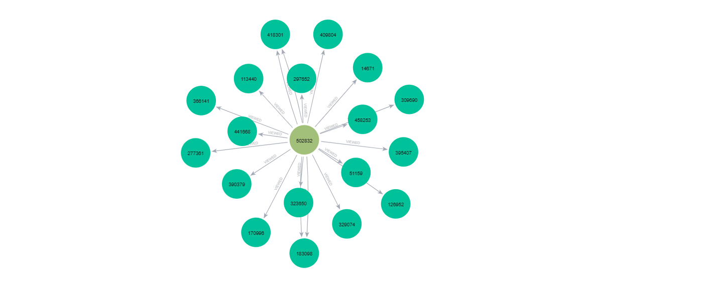
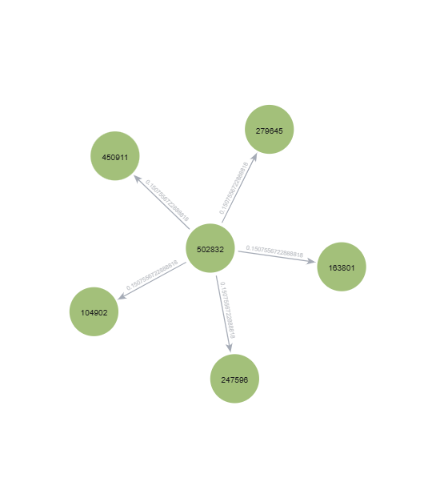
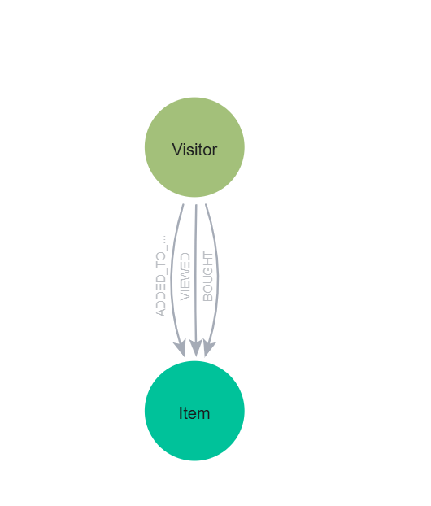

# UTS Graf Sains Data — Neo4j & Rekomendasi (RetailRocket)

**Nama:** Nailah Masruroh  **NIM:** *23031554100*  **Prodi:** S1 Sains Data, UNESA  

Repositori ini berisi jawaban UTS Graf Sains Data: memuat data interaksi RetailRocket ke graf Neo4j, membentuk Vector Space Model (VSM) untuk User dan Item, menghitung similarity pada graf terproyeksi, lalu membangun rekomendasi KNN dan mengevaluasinya dengan Hit@5 dan NDCG@5.

## Isi repositori

| Berkas | Keterangan |
|---|---|
| `UTS_GSD_Neo4j_RetailRocket.ipynb` | Notebook jawaban (kode, penjelasan, dan output) |
| `data.zip` | Dataset hasil filter: `events_P1_train.csv` dan `events_P2_test.csv` |
| `images/skema_graf.png` | Screenshot skema graf Neo4j |
| `images/neo4j_before.png` | Screenshot graf interaksi sebelum similarity |
| `images/neo4j_after.png` | Screenshot graf similarity sesudah penulisan |
| `README.md` | Penjelasan jawaban (berkas ini) |

Dataset asli berasal dari [RetailRocket e-commerce dataset (Kaggle)](https://www.kaggle.com/datasets/retailrocket/ecommerce-dataset), yaitu berkas `events.csv`. Karena ukurannya besar, data mentah tidak diunggah ke repositori. Data hasil filter P1 dan P2 disediakan dalam `data.zip`.

Ekstrak `data.zip` sehingga kedua berkas berada pada lokasi berikut:
- `data/events_P1_train.csv` — data training periode P1.
- `data/events_P2_test.csv` — data testing periode P2.

Untuk menjalankan notebook dari awal, unduh juga `events.csv` dari Kaggle dan letakkan di folder `data/`, karena sel persiapan data membaca berkas mentah tersebut untuk membuat ulang CSV P1 dan P2.

## Cara menjalankan

1. Jalankan database khusus tugas di Neo4j Desktop. Konfigurasi notebook memakai `bolt://localhost:7687`, user `neo4j`, dan database `neo4j`.
2. Buat environment melalui terminal:

   ```bash
   python -m venv myenv
   ```

   Aktifkan di Windows PowerShell:

   ```powershell
   .\myenv\Scripts\Activate.ps1
   ```

   Atau di Linux/macOS:

   ```bash
   source myenv/bin/activate
   ```

3. Instal dependensi:

   ```bash
   pip install neo4j pandas numpy scipy networkx matplotlib tqdm jupyter ipykernel pillow
   ```

4. Unduh data mentah dari Kaggle dan tempatkan `events.csv` di `data/`. Notebook membaca data mentah ini untuk membuat ulang CSV P1/P2; CSV hasil filter saja belum cukup untuk menjalankan notebook tanpa perubahan kode.
5. Pastikan ketiga gambar pada tabel isi repositori tersedia di folder `images/`.
6. Buka notebook, pilih kernel environment tersebut, lalu periksa periode, koneksi database, dan `RESET_DB` pada sel konfigurasi. Password diambil dari environment variable `NEO4J_PASSWORD` atau diminta melalui `getpass`.
7. Jalankan **Restart Kernel → Run All**, lalu simpan notebook agar seluruh output tabel dan gambar ikut tersimpan.


**Perilaku reset dan impor.** Kode terbaru menetapkan `RESET_DB = True`, yang menghapus seluruh simpul dan relasi database tujuan sebelum impor. Gunakan database khusus tugas. Mengganti menjadi `False` tidak membuat impor idempoten: relasi event dibuat dengan `CREATE`, sehingga mengimpor ulang data yang sama dapat menggandakan relasi. Sel penulisan similarity juga menghapus semua relasi `SIMILAR_TO` sebelum menulis hasil terbaru.

## Konfigurasi yang dipakai

| Parameter | Nilai |
|---|---|
| Periode P1 (training) | 2015-05-13 s.d. 2015-08-01 |
| Periode P2 (testing) | 2015-08-02 s.d. 2015-08-22 |
| Filter visitor | ≥ 3 event di P1 (`MIN_EVENTS_P1 = 3`) |
| Seed acak | 2026 |
| k (KNN) | 5 |
| Metrik similarity | Cosine pada vektor biner |

Catatan: `timestamp` pada dataset berupa unix epoch **milidetik** dan data hanya mencakup 3 Mei sampai 18 September 2015.

---

## 2.1 Wrangling dan EDA

### No. 1–2 — Dua periode waktu dan penyimpanan CSV
Timestamp dikonversi ke datetime, lalu data difilter menjadi P1 dan P2 yang tidak saling tumpang tindih. Hanya visitor dengan minimal 3 event di P1 yang dipertahankan,
baik pada P1 maupun P2. Filter ini memilih visitor berdasarkan
tingkat aktivitas pada periode training, bukan jumlah item unik. Hasilnya disimpan sebagai `events_P1_train.csv` dan `events_P2_test.csv`.

| Periode | Baris | Visitor | Item |
|---|---|---|---|
| P1 (train) | 843.808 | 124.711 | 102.913 |
| P2 (test) | 34.751 | 6.148 | 15.508 |

P1 dimuat ke Neo4j dengan mekanisme batch (5.000 baris per batch): `MERGE` untuk simpul `Visitor` dan `Item`, `CREATE` untuk relasi `VIEWED`, `ADDED_TO_CART`, dan `BOUGHT` (membawa `timestamp`, dan `transactionId` untuk `BOUGHT`). Constraint unik dibuat pada `Visitor.visitorId` dan `Item.itemId`.

### No. 3 — Komposisi subgraph
Query Cypher (dijalankan dengan Python API `neo4j`):

```cypher
MATCH (n) UNWIND labels(n) AS label RETURN label, count(*) AS jumlah ORDER BY jumlah DESC
MATCH ()-[r]->() RETURN type(r) AS relasi, count(*) AS jumlah ORDER BY jumlah DESC
```

`UNWIND labels(n)` memecah label setiap simpul menjadi baris sehingga `count(*)` menghitung jumlah simpul per jenis. `type(r)` mengelompokkan relasi per jenis.

| Simpul | Jumlah | | Relasi | Jumlah |
|---|---|---|---|---|
| Visitor | 124.711 | | VIEWED | 793.197 |
| Item | 102.913 | | ADDED_TO_CART | 36.931 |
| | | | BOUGHT | 13.680 |

Total relasi 843.808 sama dengan jumlah baris P1. Graf ini bipartit: relasi hanya menghubungkan Visitor ke Item.

### No. 4 — VSM untuk simpul User (Visitor)
Setiap visitor dinyatakan sebagai vektor pada ruang item. Matriks `A` bersifat biner (1 jika visitor pernah berinteraksi dengan item, apa pun jenis eventnya) dan disimpan dalam format sparse CSR.

- Shape: **124.711 × 102.913** (dimensi vektor = 102.913 item)
- Non-zero: 511.584, sparsity **99,996%**
- Derajat per visitor: min 1, median 3, rata-rata 4,1, maks 2.584
- Ukuran jika dense float64 sekitar 102,68 GB per matriks, sehingga representasi sparse CSR lebih sesuai

Plot networkx proyeksi User–User (25 visitor teraktif, tebal sisi = cosine) ada di notebook.

### No. 5 — VSM untuk simpul Item
Setiap item dinyatakan sebagai vektor pada ruang visitor, yaitu `Aᵀ`.

- Shape: **102.913 × 124.711** (dimensi vektor = 124.711 visitor)
- Non-zero dan sparsity sama dengan `A` (transpose)
- Derajat per item: min 1, median 2, rata-rata 5,0, maks 539 visitor

Plot networkx proyeksi Item–Item ada di notebook.

### No. 6 — Proyeksi yang lebih baik
Dua kriteria dibandingkan.

**Efisiensi.** Kode menghitung batas atas sisi sebagai `min(Σ C(d,2), C(n,2))`. Untuk proyeksi User, `d` adalah derajat item; untuk proyeksi Item, `d` adalah derajat user. Pasangan yang sama dapat terhitung melalui beberapa tetangga bersama. Angka ini bukan jumlah sisi unik aktual dan bukan hasil pengukuran waktu eksekusi.

| Proyeksi | Jumlah simpul | Batas atas sisi | Estimasi similarity dense float64 |
|---|---:|---:|---:|
| User–User (Visitor) | 124.711 | 6.967.511 | 124,42 GB |
| Item–Item | 102.913 | 18.106.789 | 84,73 GB |

Estimasi dense pada tabel berlaku untuk matriks similarity persegi; berbeda dengan estimasi 102,68 GB untuk matriks VSM user × item.

**Efektivitas.** Evaluasi menggunakan seluruh **4.244 user** dengan ground truth layak, bukan sampel 200 user. Kedua metode memakai user dan aturan ground truth yang sama, KNN k=5, serta fallback populer ketika kandidat tidak cukup.

| Proyeksi | Hit@5 | NDCG@5 | Jumlah user |
|---|---:|---:|---:|
| User–User (Visitor) | 0,034637 | 0,015648 | 4.244 |
| Item–Item | 0,032752 | 0,014904 | 4.244 |

**Kesimpulan.** Proyeksi **Visitor** dipilih karena memiliki Hit@5 tertinggi, dengan NDCG@5 sebagai pembeda jika Hit@5 seri. Batas atas sisi Item sekitar 2,60 kali Visitor, sedangkan Item memiliki simpul lebih sedikit dan estimasi similarity dense lebih rendah. Berdasarkan indikator kandidat sisi, Visitor lebih menguntungkan, tetapi kecepatan dan penggunaan memori aktual tidak diukur. Selisih efektivitas belum diuji signifikansinya. P2 digunakan untuk pemilihan proyeksi sekaligus pelaporan metrik, sehingga hasilnya merupakan evaluasi eksploratif, bukan pengujian independen setelah pemilihan model.

### No. 7 — Similarity pada graf terproyeksi
Similarity yang dipakai adalah cosine pada vektor biner:

`cos(a, b) = |N(a) ∩ N(b)| / √(|N(a)| · |N(b)|)`

Dihitung dengan perkalian matriks sparse per chunk, dan diambil **hingga 5 tetangga dengan cosine positif** untuk setiap simpul yang diproses. Urutannya cosine menurun, kemudian ID menaik saat skor seri; aturan ini sama di Python dan Cypher. Similarity dihitung untuk 2.000 visitor teraktif ditambah simpul acuan. Simpul acuan dipilih acak (seed 2026) dari 200 visitor teraktif: **Visitor 502832** (derajat 88).

**(a) Query Cypher top-5** (dihitung langsung di database):

```cypher
MATCH (a:Visitor {visitorId: $ref})-[:VIEWED|ADDED_TO_CART|BOUGHT]->(x:Item)<-[:VIEWED|ADDED_TO_CART|BOUGHT]-(b:Visitor)
WHERE a <> b
WITH a, b, count(DISTINCT x) AS irisan
MATCH (a)-[:VIEWED|ADDED_TO_CART|BOUGHT]->(xa:Item) WITH a, b, irisan, count(DISTINCT xa) AS deg_a
MATCH (b)-[:VIEWED|ADDED_TO_CART|BOUGHT]->(xb:Item) WITH a, b, irisan, deg_a, count(DISTINCT xb) AS deg_b
RETURN b.visitorId AS id, irisan, deg_a, deg_b, irisan / sqrt(toFloat(deg_a) * deg_b) AS cosine
ORDER BY cosine DESC, id ASC LIMIT 5
```

`irisan` adalah jumlah item yang sama-sama dilihat, `deg_a` dan `deg_b` adalah jumlah item masing-masing visitor.

| id | irisan | deg_a | deg_b | cosine |
|---|---|---|---|---|
| 104902 | 2 | 88 | 2 | 0,150756 |
| 163801 | 2 | 88 | 2 | 0,150756 |
| 247596 | 2 | 88 | 2 | 0,150756 |
| 279645 | 2 | 88 | 2 | 0,150756 |
| 450911 | 2 | 88 | 2 | 0,150756 |

Hasil ini identik dengan perhitungan Python. Kelima tetangga memiliki skor yang sama (kasus seri, karena masing-masing hanya punya 2 item dan keduanya dimiliki visitor acuan), sehingga urutannya ditentukan oleh `id`.

**(b) Menulis kembali similarity ke graf.** Nilai cosine disimpan sebagai relasi `SIMILAR_TO`:

```cypher
UNWIND $rows AS r
MATCH (a:Visitor {visitorId: r.a}) MATCH (b:Visitor {visitorId: r.b})
MERGE (a)-[s:SIMILAR_TO]->(b) SET s.score = r.score, s.metric = 'cosine'
```

Total relasi `SIMILAR_TO` sebelum penulisan: **0**, sesudah: **9.973**. Pembacaan kembali dari graf:

```cypher
MATCH (a:Visitor {visitorId: $ref})-[s:SIMILAR_TO]->(b:Visitor)
RETURN a.visitorId AS a, b.visitorId AS b, s.score AS score ORDER BY score DESC, b
```

Hasilnya sama dengan tabel di atas (skor 0,150756 untuk kelima tetangga).

### No. 8 — Kondisi sebelum dan sesudah similarity

```cypher
// SEBELUM: hanya relasi interaksi
MATCH p=(a:Visitor {visitorId: 502832})-[:VIEWED|ADDED_TO_CART|BOUGHT]->(x:Item) RETURN p LIMIT 20

// SESUDAH: ditambah relasi similarity
MATCH p=(a:Visitor {visitorId: 502832})-[:SIMILAR_TO]->(b:Visitor) RETURN p
```

Sebelum: tidak ada relasi `SIMILAR_TO` (jumlah 0), simpul acuan hanya terhubung ke item. Sesudah: simpul acuan memiliki 5 relasi `SIMILAR_TO` berbobot `score` ke 5 visitor termirip. Graf dari Neo4j Browser:

| Sebelum similarity | Sesudah similarity |
|---|---|
|  |  |

Notebook juga menampilkan kedua screenshot berdampingan dengan pemotongan tepi kosong saat ditampilkan, tanpa mengubah file asli. Visualisasi networkx menjadi pendamping. `Q_BEFORE` dan `Q_AFTER` menampilkan pola relasi berbeda: query pertama sendiri tidak membuktikan ketiadaan `SIMILAR_TO`; jumlah sebelum/sesudah mengacu pada output eksekusi tersimpan.

Skema graf:



---

## 2.2 Analytics

### No. 1 — User acak dan rekomendasi KNN
- **Proses acak (reproducible):** `np.random.default_rng(2026).choice(...)` memilih satu visitor dari himpunan visitor yang ada di graf P1 dan memiliki minimal satu item relevan di P2. Dengan seed, urutan kandidat, data, dan lingkungan yang sama, pemilihan dapat direproduksi.
- **Ground truth:** `GT[u] = (item unik P2 milik u ∩ katalog item P1) − item P1 milik u`. Semua jenis event dianggap relevan secara biner. Item di luar katalog P1 dan item yang sudah diinteraksikan user di P1 dikeluarkan. User dengan `GT[u]` kosong tidak ikut evaluasi.
- **Audit ground truth:** dari 6.148 user P2 dan 22.606 pasangan user-item unik, 3.773 pasangan berada di luar katalog P1 dan 3.269 pasangan merupakan item yang sudah diinteraksikan user di P1. Tersisa 15.564 pasangan relevan untuk 4.244 user; 1.904 user tidak memiliki ground truth layak. Hitungan item audit merupakan pasangan user-item, bukan item unik global.
- **Metode (user-based KNN, k = 5):** cari 5 visitor dengan cosine tertinggi terhadap user target; item milik tetangga yang belum pernah disentuh target diberi skor berupa jumlah similarity tetangga yang memilikinya; urutkan skor menurun lalu item ID menaik. Jika kandidat kurang dari 5, diisi item dengan jumlah visitor unik P1 terbanyak yang belum pernah diinteraksikan target (skor 0, ditandai sebagai *fallback*).

**User terpilih:** visitor **1204760** (3 item di P1, 3 item relevan di P2).
Lima tetangga terdekat (visitor, cosine): (599534, 0,7071), (71060, 0,6667), (236860, 0,5774), (634409, 0,5164), (77612, 0,4082).

**(b) Tiga item yang diiklankan (k = 5):**

| itemId | skor | sumber |
|---|---|---|
| 89688 | 0,7071 | KNN |
| 276885 | 0,7071 | KNN |
| 384302 | 0,7071 | KNN |

Top-5 rekomendasi: 89688, 276885, 384302, 448418, 257898. **Tiga item pertama adalah iklan**, sedangkan **kelima item digunakan untuk Hit@5 dan NDCG@5**. Parameter k=5 menyatakan jumlah tetangga KNN, bukan jumlah iklan.

### No. 2 — Hit@5 dan NDCG@5
- **Hit@5** = 1 jika setidaknya satu item relevan berada di top-5, selain itu 0.
- **NDCG@5** = DCG@5 / IDCG@5 dengan relevansi biner, `DCG = Σ rel_i / log2(i+1)` dan `IDCG` dihitung dari `min(|relevan|, 5)` item relevan di posisi teratas.

Item relevan (P2): 162495, 189022, 331620. Tidak ada yang muncul di top-5 (relevansi per posisi: 0, 0, 0, 0, 0).

| Metrik | Nilai |
|---|---|
| Hit@5 | **0** |
| NDCG@5 | **0,0000** (DCG = 0; IDCG = 2,1309) |

Hasil nol untuk satu user sah dan seed tidak diubah untuk memperoleh hit. Sebagai konteks, rata-rata proyeksi Visitor pada 4.244 user adalah Hit@5 = 0,034637 dan NDCG@5 = 0,015648 (No. 6). Metrik satu user bukan pengganti rata-rata seluruh user layak.

---

## Keterbatasan dan catatan

- **Data sangat jarang.** Rata-rata hanya sekitar 4,1 item unik per visitor dan sparsity 99,996%, sehingga kemiripan antar visitor mudah berupa irisan kecil dan banyak kasus seri. Kondisi ini dapat berkontribusi pada rendahnya Hit@5 dan NDCG@5, tetapi penyebabnya tidak diuji secara terpisah.
- **Periode evaluasi pendek.** P2 hanya sekitar tiga minggu sehingga jumlah item relevan per user sangat sedikit.
- **Evaluasi satu user tidak representatif.** Nilai Hit@5/NDCG@5 untuk satu user hanya menjadi contoh; rata-rata pada seluruh 4.244 user layak lebih informatif.
- **Pemilihan proyeksi memakai fold P2.** Perbandingan efektivitas pada No. 6 memakai data P2 yang juga dipakai untuk evaluasi No. 2, sehingga hasil P2 bukan pengujian independen setelah pemilihan model. Periode validasi dan testing terpisah diperlukan untuk evaluasi independen. Pemilihan dalam kode mengikuti Hit@5, lalu NDCG@5.
- **Similarity hanya biner.** Jenis event (view, add to cart, buy) tidak dibedakan bobotnya; pengembangan lanjutan dapat memakai bobot berbeda per jenis event.
- **Similarity disimpan untuk subset simpul** (2.000 visitor teraktif dan simpul acuan), bukan seluruh 124.711 visitor, agar jumlah relasi dan waktu komputasi terkendali. KNN untuk user target dihitung langsung terhadap seluruh visitor.

